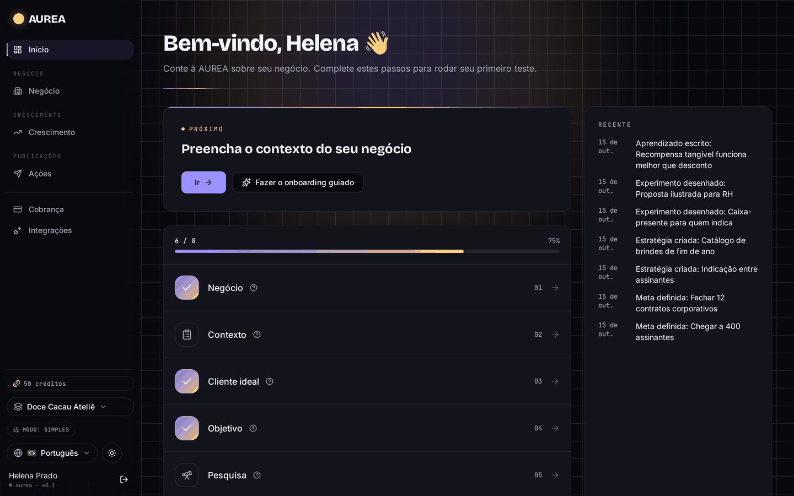
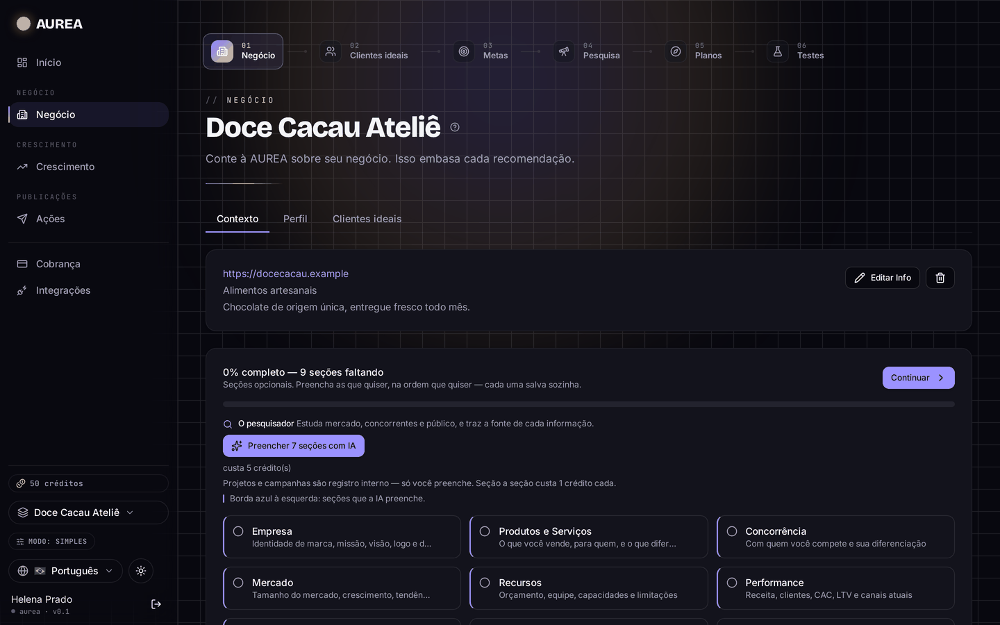
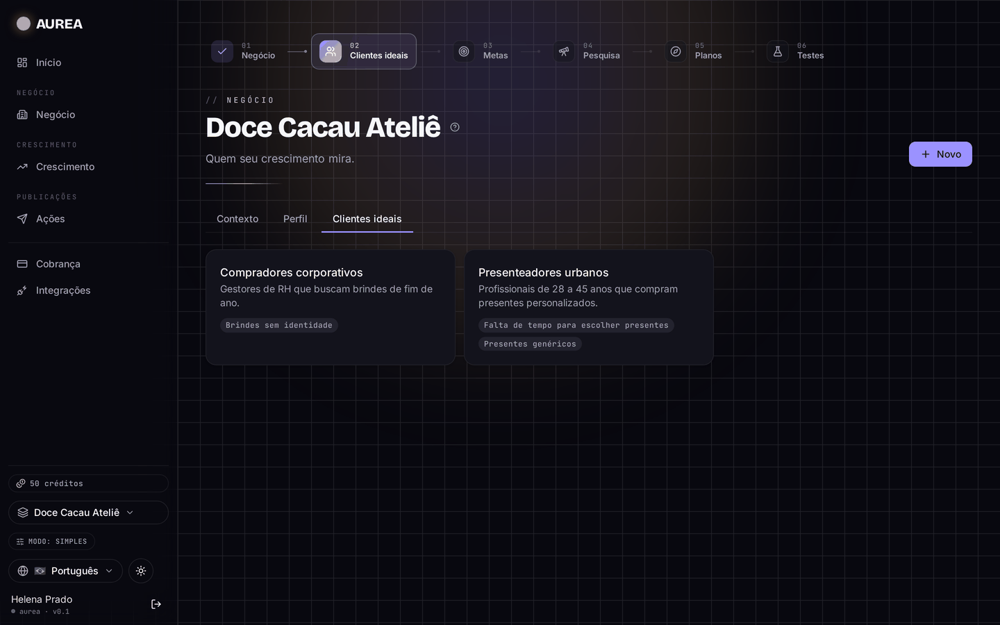
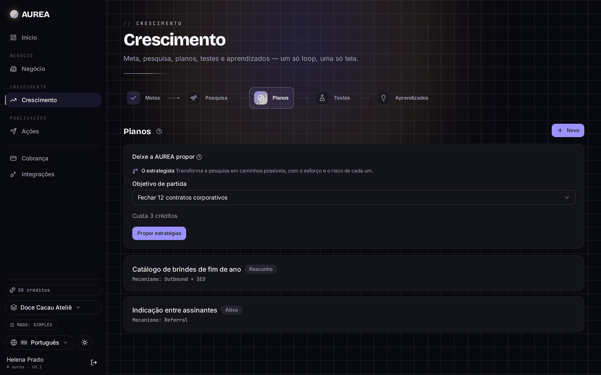
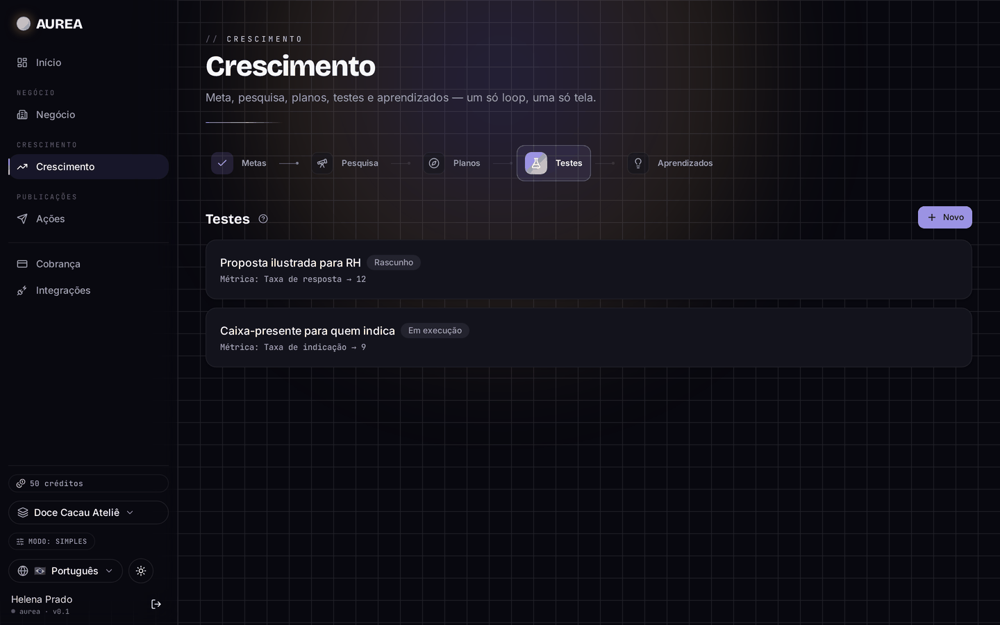
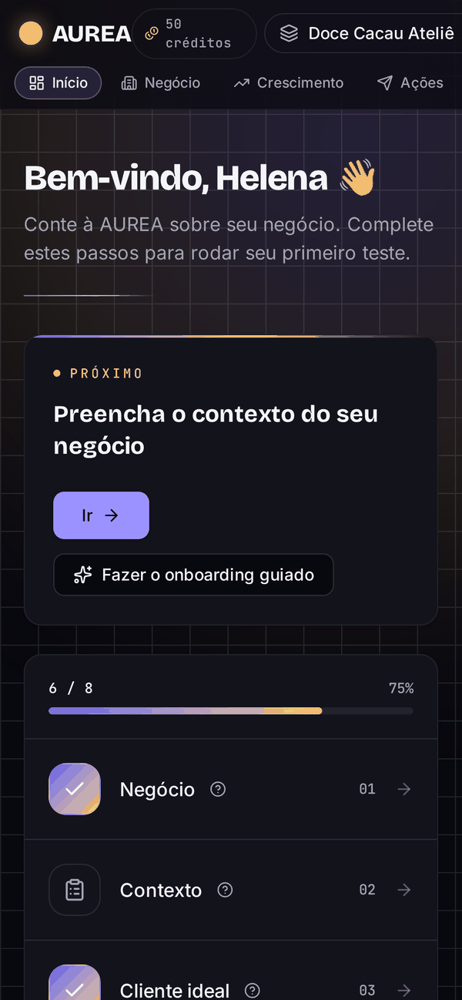
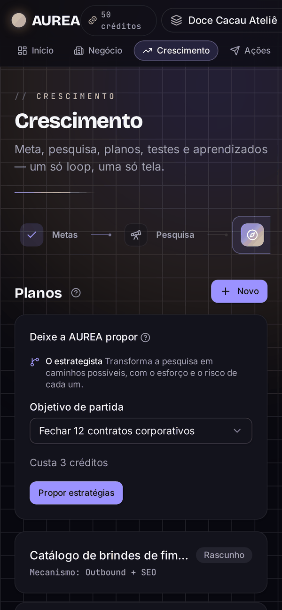
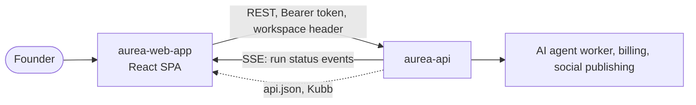
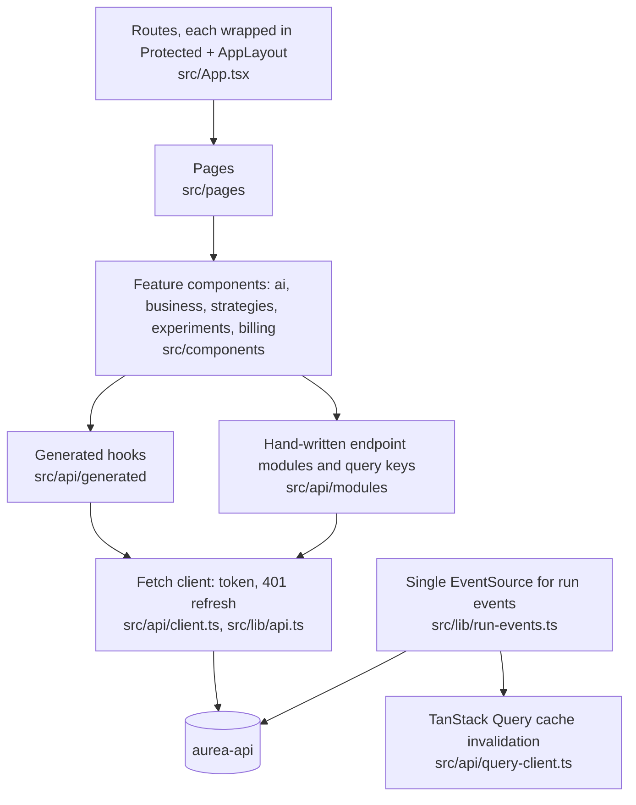
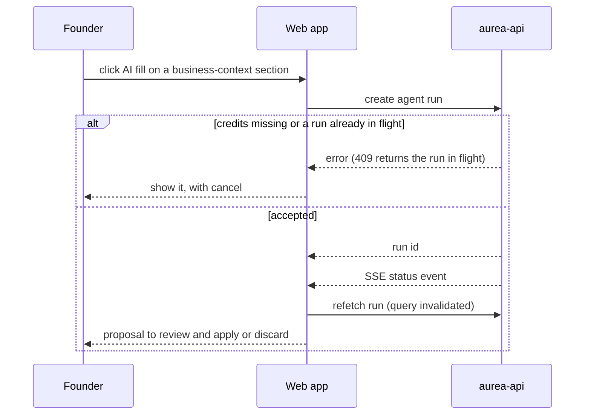

# Aurea Web App

React frontend for Aurea, an AI growth operating system: founders define business context and goals, review AI-proposed strategies and experiments, and track results.

**Status:** Prototype, not in production. UI is localized (en, pt, es).

## What it does

- Auth and workspace/organization screens, business context editors with AI "fill" proposals.
- Goals, strategies, experiments and actions with in-app explanations of domain terms.
- Integrations (GA4 service account, social accounts) and billing/credits screens.
- i18n with three locales; typed API client generated from OpenAPI (Kubb).

## Screenshots

Captured from a local run with fictitious seed data (a made-up bakery workspace, no real users). The app is dark-only; the UI is in Portuguese.

<table>
  <tr>
    <td width="50%"><br><sub>Dashboard: onboarding progress and recent activity.</sub></td>
    <td width="50%"><br><sub>Business profile and context sections.</sub></td>
  </tr>
  <tr>
    <td width="50%"><br><sub>Ideal customer profiles.</sub></td>
    <td width="50%"><br><sub>Growth loop, Plans stage: one active and one draft strategy.</sub></td>
  </tr>
  <tr>
    <td width="50%"><br><sub>Growth loop, Tests stage: one running and one draft experiment.</sub></td>
  </tr>
</table>

<table>
  <tr>
    <td width="25%"><br><sub>Dashboard on mobile.</sub></td>
    <td width="25%"><br><sub>Strategies on mobile.</sub></td>
  </tr>
</table>

## Architecture

System context: the web app only talks to aurea-api.



Layers inside this repo:



Main flow, an AI "fill" proposal (`src/components/ai/useFillRun.ts`, `src/lib/run-events.ts`):



- All server calls go through `src/api/client.ts`; generated types/hooks come from `api.json` via `pnpm api:generate`.
- One app-wide `EventSource` instead of one per component, because each route remounts the layout; it reopens after errors and when the workspace changes.
- A 401 triggers one refresh attempt and a retry before the session is cleared.
- Tailwind + shadcn/ui for styling; form schemas in `src/schemas`; strings in three locales under `src/i18n/locales`, with tests that check key coverage.

## Tech stack

Vite, React 19, TypeScript (strict), react-router 7, TanStack Query, React Hook Form + Zod, Tailwind 4, Radix, i18next, Vitest.

## Getting started

Prerequisites: Node 22, pnpm 10, a running aurea-api.

```bash
cp .env.example .env     # VITE_API_URL: base URL of aurea-api
pnpm install
pnpm dev                 # http://localhost:5173
pnpm typecheck && pnpm test && pnpm build
```

| Variable | Purpose |
|---|---|
| `VITE_API_URL` | Base URL of the API |

## Testing

115 test files (Vitest + Testing Library); run `pnpm test`.

## Project structure

```
src/   pages, components, lib, api (generated), schemas, i18n
docs/  plans and specs
```

## Related repositories

- [aurea-api](https://github.com/mkwitko/aurea-api): backend (growth domain model, AI agents, billing).

## License

All rights reserved. Source available for portfolio review.
