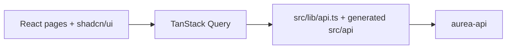

# Aurea Web App

React frontend for Aurea, an AI growth operating system: founders define business context and goals, review AI-proposed strategies and experiments, and track results.

**Status:** Prototype, not in production. UI is localized (en, pt, es).

## What it does

- Auth and workspace/organization screens, business context editors with AI "fill" proposals.
- Goals, strategies, experiments and actions with in-app explanations of domain terms.
- Integrations (GA4 service account, social accounts) and billing/credits screens.
- i18n with three locales; typed API client generated from OpenAPI (Kubb).

## Architecture



- All server calls go through `src/lib/api.ts`; generated types/hooks come from `api.json` via `pnpm api:generate`.
- Tailwind + shadcn/ui for styling; schemas in `src/schemas`.

## Tech stack

Vite, React 19, TypeScript (strict), react-router 7, TanStack Query, React Hook Form + Zod, Tailwind 4, Radix, i18next, Vitest.

## Getting started

Prerequisites: Node 22, pnpm 10, a running aurea-api.

```bash
cp .env.example .env     # VITE_API_URL: base URL of aurea-api
pnpm install
pnpm dev                 # http://localhost:5173
pnpm typecheck && pnpm test && pnpm build
```

| Variable | Purpose |
|---|---|
| `VITE_API_URL` | Base URL of the API |

## Project structure

```
src/   pages, components, lib, api (generated), schemas, i18n
docs/  plans and specs
```

## Related repositories

- [aurea-api](https://github.com/mkwitko/aurea-api): backend (Growth Brain, AI agents, billing).
- [aurea-web-app](https://github.com/mkwitko/aurea-web-app): React frontend.

## License

All rights reserved. Source available for portfolio review.
